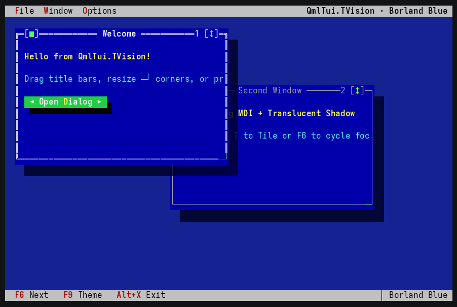

# `QmlTui.TVision`

Borland Turbo Vision-inspired **Multi-Document Interface (MDI)** desktop windowing, pull-down menus, tilde-mnemonics, beveled buttons, modal dialogs, built-in & custom themes, and custom `TextGridBuffer` primitives (`TvDesktopSurface`, `TvDropShadow`, `TvDragHandle`) built natively on [QmlTui](https://github.com/qmltui/qmltui)'s retained-mode QML scene graph.



For a full-scale application built on `QmlTui.TVision`, see [`turbo_hex`](https://github.com/qmltui/apps/tree/main/apps/turbo_hex) in [`qmltui/apps`](https://github.com/qmltui/apps).

## Provided Types (`import QmlTui.TVision`)

| Type | Kind | Summary |
| :--- | :--- | :--- |
| `TvDesktop` | QML `Item` | MDI workspace managing overlapping `TvWindow` children, `z`-order activation, `1..9` window numbering, `Tile`, `Cascade`, `F5` zoom, and `F6` cycling. |
| `TvWindow` | QML `FocusScope` | Draggable, resizable, zoomable, closable MDI window with `[■]` close box, `[↕]` zoom toggle, `Ctrl+F5` keyboard move/resize mode, `palette` override, and `TvDropShadow`. |
| `TvMenuBar` | QML `Rectangle` | 1-row top menu bar supporting `Alt+<Mnemonic>`, `F10` → `<Mnemonic>` bar-focus mode, plain-key fallback, and pull-down `TvMenu` popups. |
| `TvMenu` | QML `Popup` | Pull-down menu with `~mnemonic~` hotkeys, right-aligned shortcut chords, `├─┤` separators, and translucent drop shadow. |
| `TvStatusLine` | QML `Rectangle` | 1-row bottom command bar displaying clickable hotkey hints and right-aligned status telemetry. |
| `TvDialog` | QML `Popup` | Centered modal Turbo Vision dialog box with double-line chrome, `[■]` close button, button mnemonic routing, `palette` override, and `TvDropShadow`. |
| `TvButton` | QML `Item` | Classic 2-row 3D beveled button (`◄ OK ►▄` / `▀▀▀▀▀▀`) with pressed shift feedback and `~mnemonic~` highlighting. |
| `TvPalette` | C++ `QObject` | Declarative theme token set (`copyFrom()`, `applyMap()`, `toMap()`, `reset()`) plus exported QML presets (`BorlandBlueTheme`, `TurboCyanTheme`, `DarkDosTheme`, `MonochromeTheme`). |
| `TvTheme` | QML Singleton | Reactive theme registry managing built-in presets, registered `customSchemes`, live `customPalette` overrides, JS/JSON `registerThemeObject()`, and desktop stipple patterns. |
| `TvMnemonic` | QML Singleton | Parses Borland `~F~ile` tilde-mnemonics into stripped strings, hotkey characters, and styled `QmlTui.span` arrays. |
| `TvDesktopSurface` | C++ `Item` | Single-pass `BoundedSelfPaint` item filling stippled desktop backgrounds directly into `TextGridBuffer`. |
| `TvDropShadow` | C++ `Item` | Click-through (`enabled: false`) translucent shadow darkening underlying `Cell` RGB channels and setting `TextAttribute::Dim` without erasing glyphs. |
| `TvDragHandle` | C++ `Item` | Screen-space pointer drag/resize primitive avoiding local-coordinate feedback stalls when parent windows move during drags. |

## Custom Themes

`QmlTui.TVision` ships four built-in themes (`BorlandBlueTheme`, `TurboCyanTheme`, `DarkDosTheme`, and `MonochromeTheme`) and supports custom themes in three ways. Every color token accepts `#rrggbb` hex strings, CSS color names, terminal-native ANSI indices (`"ansi:brightyellow"`), `"default"`, or `"transparent"`.

### 1. Declarative QML Theme (Full `TvPalette` or Extending a Built-In Theme)

Subclass any built-in theme (`DarkDosTheme`, `BorlandBlueTheme`, `TurboCyanTheme`, `MonochromeTheme`) to override only the tokens you want, or instantiate `TvPalette` directly. Register it with `TvTheme.registerScheme(...)` so `TvTheme.cycleScheme()`, `TvTheme.setScheme(...)`, and `TvTheme.schemeDescriptions` include it automatically (set `TvTheme.includeBuiltInSchemes = false` to expose only your custom themes, or assign `TvTheme.customPalette = myTheme` for a single fixed theme):

```qml
DarkDosTheme {
    id: draculaTheme

    schemeId: "dracula"
    schemeTitle: "Dracula"
    description: "Dracula (Purple Dark)"
    desktopBg: "#1e1f29"
    desktopFg: "#44475a"
    winBg: "#282a36"
    winFg: "#f8f8f2"
    winActiveBorder: "#bd93f9"
    buttonBg: "#50fa7b"
    buttonFocusedBg: "#69ff94"
    buttonFg: "#282a36"
}

Component.onCompleted: {
    TvTheme.registerScheme(draculaTheme);
    TvTheme.setScheme("dracula");
}
```

### 2. Dynamic JS / JSON Theme Map

Load partial token maps (for example from a user JSON config file) on top of any `"baseScheme"` (`"borland_blue"`, `"turbo_cyan"`, `"dark_dos"`, `"monochrome"`, or an already-registered custom scheme):

```qml
Component.onCompleted: {
    // Register into the theme cycle (or call TvTheme.applyCustomTheme({...}) for a one-off override)
    TvTheme.registerThemeObject({
        baseScheme: "dark_dos",
        schemeId: "amber_crt",
        schemeTitle: "Amber CRT",
        description: "Amber CRT (Phosphor P3)",
        winBg: "#1a0d00",
        winFg: "#ffb000",
        winActiveBorder: "#ffd866"
    });
    TvTheme.setScheme("amber_crt");
}
```

`TvPalette` also exposes `copyFrom(source)`, `applyMap(map)`, `toMap()`, and `reset()` to C++ and QML for config serialization.

### 3. Scoped Per-Window / Per-Dialog Palette

Every visual control (`TvDesktop`, `TvWindow`, `TvDialog`, `TvButton`, `TvMenuBar`, `TvMenu`, `TvStatusLine`) exposes an optional `palette` property that overrides `TvTheme.activePalette` for just that component (such as a crimson Borland alert dialog):

```qml
BorlandBlueTheme {
    id: errorAlertPalette
    dialogBg: "#660000"
    dialogFg: "#ffffff"
    dialogActiveBorder: "#ffff55"
    buttonBg: "#aa0000"
    buttonFocusedBg: "#ff3333"
    buttonFg: "#ffffff"
}

TvDialog {
    title: "Checksum Error"
    palette: errorAlertPalette
}
```

## Consuming via CMake `FetchContent`

```cmake
include(FetchContent)
FetchContent_Declare(
    qmltui_tvision
    GIT_REPOSITORY https://github.com/qmltui/tvision.git
    GIT_TAG main
    GIT_SHALLOW TRUE
)
FetchContent_MakeAvailable(qmltui_tvision)

target_link_libraries(my_app PRIVATE QmlTui::Core QmlTui::Controls QmlTui::TVision)
```

In `qt_add_qml_module`, declare `DEPENDENCIES TARGET QmlTuiTVision` for `qmllint` static analysis, then import `QmlTui.TVision`:

```qml
pragma ComponentBehavior: Bound
import QmlTui
import QmlTui.TVision
```

## Standalone Build & Tests

```sh
cmake -S . -B build -G Ninja -DFETCHCONTENT_SOURCE_DIR_QMLTUI=/path/to/qmltui
cmake --build build
ctest --test-dir build --output-on-failure
./build/examples/hello_tvision/tvision_hello
```
